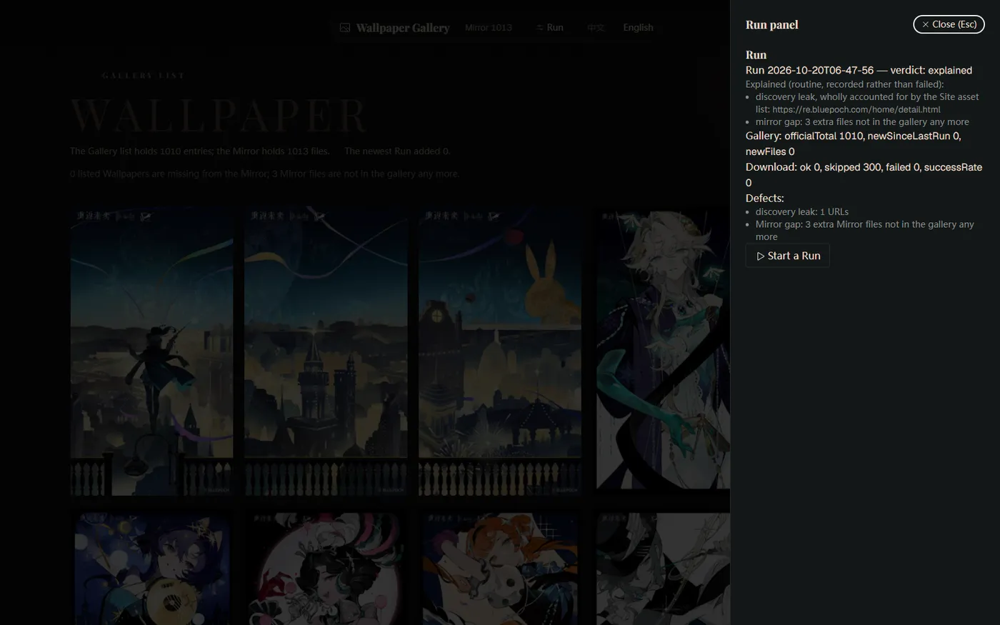

# Reverse: 1999 Wallpaper Downloader

[中文](README.md) | **English**

Download every wallpaper from the [official gallery](https://re.bluepoch.com/home/detail.html#wallpaper) to your own computer, browse them on one page, and top up whenever you like. It runs on your own machine only — nobody else can reach it.


## First time only

Install [Node 22](https://nodejs.org), [pnpm](https://pnpm.io) and Chrome first. Then open a terminal **in this folder** and copy the commands below one line at a time, pressing Enter after each:

```bash
npm install -g @playwright/cli
npx playwright-cli install
pnpm install
```

## Start it

```bash
pnpm webui
```

Your browser opens a page, and that page is the whole app:



- The first start takes a little while; later starts are quick.
- If no page opens, copy the whole address the terminal printed into your browser (the tail end is a key — keep it).

Click **Run** in the top-right corner. A Chrome window opens by itself, flips through the whole gallery, and downloads what it finds.

## What the page does

- **The wall**: five columns, every wallpaper at its own proportions, uncropped. An outlined tile means the gallery has it and you do not yet.
- **Click a tile**: view the original, zoom in and out, press Esc to close.
- **Run**: start downloading, or top up what is missing; click it again after a Run to see the result.
- **The numbers**: "Mirror 1013" is how many you have; "Gallery list 1010" is how many the site holds; the next line says how many are missing and how many are extra.
- **Language**: switch between 中文 and English at any time; your choice is remembered.

## While a Run is going

- A Chrome window opens and flips pages by itself — don't click in it, and don't close it.
- Closing the page does not stop the download; to stop, press Ctrl+C in the terminal, and the download stops with it.
- Re-running is safe: files you already have are skipped, so only new wallpapers are fetched.

## Reading the result

When a Run ends, the Run panel gives one of three verdicts:

- **clean**: everything was fine.
- **explained**: something routine was recorded (such as the site's own background art being excluded correctly) without affecting your copy.
- **defect**: this Run did not see everything, or some files failed. Running it once more usually settles it.

## If something looks off

- **"Set up the site first"**: the `.env` file is missing. Create a plain text file named `.env` in this folder with these two lines, save it, then refresh the page:

  ```
  BASE_ORIGIN=https://re.bluepoch.com
  PAGE_PATH=/home/detail.html
  ```

  On Windows you can name it `.env.` (one extra dot) and press Enter — Windows drops the dot for you.

- **"Orphaned Run"**: a leftover record from an interrupted Run. Click **Clean up**, then start a new Run.
- **A tile says "not on disk"**: the gallery has it, but it is not downloaded yet; the next Run fetches it.
- **Need help**: keep the newest file in the `logs` folder — it records each Run end to end.

## Where the files go

- `images`: every wallpaper.
- `logs`: one record per Run.

## For developers

See [AGENTS.md](AGENTS.md) for the architecture, the commands and the conventions; [CONTEXT.md](CONTEXT.md) and `docs/adr/` for the vocabulary and the decisions.
