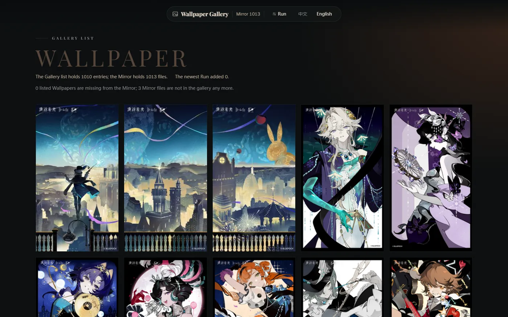

# Reverse: 1999 Wallpaper Downloader

[中文](README.md) | **English**

The tool downloads every wallpaper from the [official gallery](https://re.bluepoch.com/home/detail.html#wallpaper) to your computer and shows them on one page. The service runs locally only; other devices cannot reach it.



## Before you start

Install Node 22 and pnpm. Open a terminal at the project root (on Windows, PowerShell) and run:

```bash
pnpm install
pnpm build
```

`pnpm build` produces the program itself (`build/`): the two bundled entries and the prebuilt page. The program runs from that output only and compiles nothing at start, so a fresh checkout has to be built once.

## Start it

```bash
pnpm webui
```

The browser opens:

```
WebUI: http://127.0.0.1:8791/?token=…
```

## The page

“Mirror 1013” is how many you already have; “Gallery list 1010” is how many the site holds. The next line gives two counts: wallpapers the gallery lists but you do not have, and local files the gallery no longer lists.

## While a Run is going

A Run asks the site for its complete list once, then downloads every entry in parallel: there is no browser window, and no login is needed.

Press Ctrl+C to end the service, and unfinished downloads stop with it.

Files already on disk are skipped; only new wallpapers are fetched.

## Reading the result

When a Run ends, the Run panel gives one of three verdicts:

- clean: nothing was flagged.
- explained: a routine case, such as a few local files the gallery has since removed. These are recorded without affecting your copy.
- defect: this Run could not read the site's list, or some files failed. Running it once more usually settles it.

## Common problems

- “Set up the site first”: the `.env` file is missing. Create a file at the project root named `.env` and write this line.

  ```
  BASE_ORIGIN=https://re.bluepoch.com
  ```

## Where files go

- `images`: the wallpaper files.
- `logs`: one JSONL log per Run.
