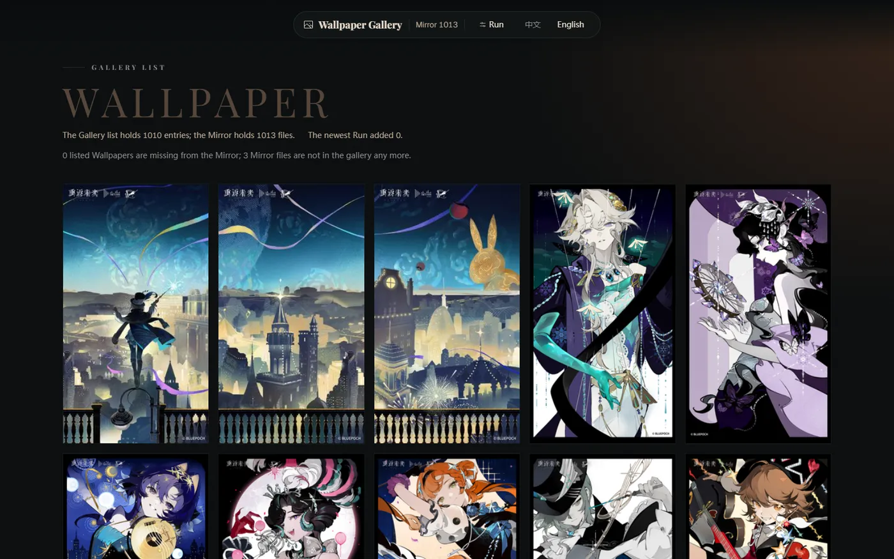

# Reverse: 1999 Wallpaper Downloader

[中文](https://github.com/makursi/re1999-wallpaper-crawler/blob/main/README.md) | **English**

Fetches the complete wallpaper list from the [official gallery](https://re.bluepoch.com/home/detail.html#wallpaper) in one request, downloads every wallpaper to this computer, and shows them on a local page. The program runs only on this machine; other devices cannot reach it.

Current version `2.0.0`

## Installation

[Node.js](https://nodejs.org/) **22.22.1 or newer** is required — check with `node -v` on a terminal. Nothing else has to be installed.

1. Download the latest `re1999-wallpaper-crawler-v<version>.zip` from [Releases](https://github.com/makursi/re1999-wallpaper-crawler/releases).
2. Extract it into any folder — Chinese characters and spaces in the path are fine. The extracted folder is the program directory: do not split it up or move files out of it.
3. Open a terminal in that folder (type `cmd` in the Explorer address bar and press Enter) and run `npm install` once. It downloads the only runtime dependency (the `sharp` thumbnail library) from the npm registry, with versions pinned by the shipped `package-lock.json`.
4. Run `npm start`. The browser opens the wallpaper page, and the terminal prints the page address as well.

If Node is too old, `npm install` fails during installation (`engine-strict` is set in the package's `.npmrc`); even with that check bypassed, the program refuses at startup with one Chinese sentence and a non-zero exit code.

## Starting and stopping

Run `npm start` in the program directory each time. If the program is already running, another `npm start` only points the browser at the running page; it does not start a second service.

Two ways to stop, with the same effect:

- close the terminal window that ran `npm start`;
- click “Exit” in the page's top navigation. While a download is running it asks for confirmation first.

Closing only the browser tab does not stop the program.

## Where the data lives

Wallpapers, logs and settings all live in the program directory under `data\`, created on the first start:

| Location | Contents |
|----------|----------|
| `data\images\` | the downloaded wallpapers, which are the wall on the page |
| `data\logs\` | one log per run |
| `data\cache\` | the thumbnail cache; deleting it only makes the next visit slower |
| `data\user.env` | optional local configuration overrides, rarely needed |

The program itself writes nothing outside the program directory: no registry entry, no system service, no uninstaller, and no pointer file recording where the installation is. The npm that runs `npm install` keeps its own download cache in the user profile; that belongs to npm, not to this program.

## Updating

Three steps; the program never replaces itself:

1. Extract the new zip into a **new folder** — do not overwrite the old folder.
2. Stop the running program, then move the whole `data\` from the old folder into the new one, next to `README.md` and `package.json`.
3. Run `npm install` once in the new folder, check the page with `npm start`, then delete the old folder.

There is no in-place overwrite: the old folder is the fallback point. Do not delete the old folder until the new version has worked properly once.

### Rolling back

If the new version misbehaves, the old folder is enough: stop the new version, move `data\` from the new folder back into the old one, and run `npm start` there. The old folder still has its program and dependencies, so nothing has to be reinstalled.

## Uninstalling

Delete the one program directory; the program and `data\` disappear with it, and there is nothing else to clean up. Why nothing outside it needs cleaning up is in “Where the data lives”.

## What the first scrape looks like

On the first visit, click “运行” in the page's top navigation, then “开始运行” (“Start a Run” after switching the page to English). Expect roughly 1,000+ wallpapers, about 2 GB in total, and 10–40 minutes depending on the connection. Stopping halfway is fine: the next “开始运行” skips what is already downloaded and fetches only the rest.

## If `npm install` fails

Failures are almost always about the dependency source or the Node version; check in this order:

1. **Node version**: `node -v` must be 22.22.1 or newer. Below that, npm reports `EBADENGINE` and exits non-zero; install a newer Node and run the command again.
2. **Registry reachability**: run `npm ping` on the same machine. Corporate networks, campus networks or proxies can block `registry.npmjs.org`.
3. **Proxy and registry settings**: read `npm config get registry` and `npm config get proxy`; when a mirror or proxy address is wrong, point npm at a reachable one with `npm config set registry <address>` and run `npm install` again.

The program itself makes no network request during installation: the whole chain uses only npm.

## Copyright

The wallpapers are the property of the official site (Bluepoch). This project does not store or distribute them: neither the repository nor the release ships an image, and the program only saves the images the official site serves onto the computer it runs on. The licence is MIT: [`LICENSE`](https://github.com/makursi/re1999-wallpaper-crawler/blob/main/LICENSE) in the repository, and the same text ships as `LICENSE.txt` in the release.

## Reporting a problem

Open an [issue](https://github.com/makursi/re1999-wallpaper-crawler/issues). Include the version shown in the page's top navigation and the newest run log under `data\logs\`.

## Source

The source code, the development commands, the directory layout and all conventions live in [AGENTS.md](https://github.com/makursi/re1999-wallpaper-crawler/blob/main/AGENTS.md) at the repository root; this README is about using the program.
