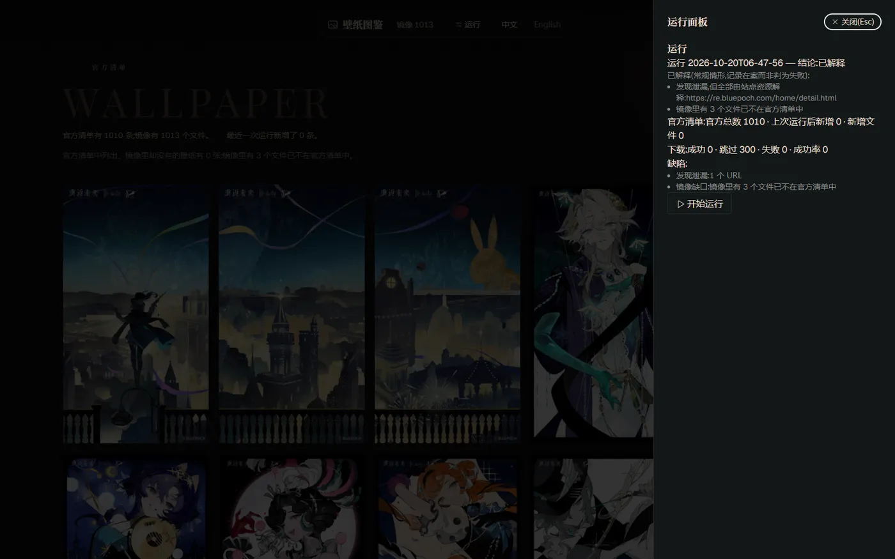

# 重返未来：1999 壁纸下载器

**中文** | [English](README.en.md)

把[官网](https://re.bluepoch.com/home/detail.html#wallpaper)上的壁纸全部下载到自己电脑里，并在一页里浏览、随时补齐。个人本地运行，别人访问不到。


## 第一次使用

先装好 [Node 22](https://nodejs.org)、[pnpm](https://pnpm.io) 和 Chrome。然后在**这个文件夹里**打开终端（Windows 叫 PowerShell），逐行复制下面的命令，每行按一次回车：

```bash
npm install -g @playwright/cli
npx playwright-cli install
pnpm install
```

## 开始使用

```bash
pnpm webui
```

浏览器会自动打开一个页面，这就是全部界面：



- 第一次打开要等一会儿，之后会快很多。
- 没自动打开的话，把终端里打印的那行网址整条复制到浏览器（末尾一串字符是钥匙，别删）。

点右上角「运行」，它会自己打开一个 Chrome 窗口，把官网壁纸翻一遍再下载下来。

## 页面上能做什么

- **一面墙**：五列，按原图比例铺开，不裁剪。灰色轮廓的格子表示官网有、你还没有。
- **点一张**：打开原图看大图，可放大缩小，按 Esc 关闭。
- **「运行」**：开始或补齐下载；结束后点它看这次的结果。
- **墙上的数字**：「镜像 1013」是你电脑里已有张数，「官方清单 1010」是官网现有张数，下一行写明差几张、多了几个。
- **语言**：页面上随时切换中文 / English，会记住你的选择。

## 运行的时候

- 会自己弹出一个 Chrome 窗口在自动翻页，别去点它，也别关它。
- 关掉网页不会停止下载；要停就在终端按 Ctrl+C，下载也会一起停。
- 可以反复运行：已经下载过的会跳过，只下新的。

## 看结果

每次运行结束，「运行」面板给出三种结论之一：

- **干净**：一切正常。
- **已解释**：有常规情况（比如官网自己的背景图被正确排除），记下来但不影响使用。
- **缺陷**：这次没抓全，或有文件没下成。再运行一次通常就好。

## 常见问题

- **提示「先完成站点配置」**：还缺 `.env` 文件。在这个文件夹里新建文本文件，命名为 `.env`，写入两行，保存后刷新页面：

  ```
  BASE_ORIGIN=https://re.bluepoch.com
  PAGE_PATH=/home/detail.html
  ```

  Windows 上可以在文件名末尾多打一个点（`.env.`）再回车，系统会自动去掉那个点。

- **提示「孤儿运行」**：上次运行被打断留下的记录，点「清理」即可，然后重新运行。
- **某个格子写着「未落盘」**：官网有这张，但还没下到本地，下次运行会补上。
- **想找人帮忙**：把 `logs` 文件夹里最新的那个文件留着，里面记着每次运行的全过程。

## 文件在哪

- `images` 文件夹：所有壁纸。
- `logs` 文件夹：每次运行的记录。

## 给开发者

架构、命令与约定见 [AGENTS.md](AGENTS.md)，词汇与决策见 [CONTEXT.md](CONTEXT.md) 和 `docs/adr/`。
